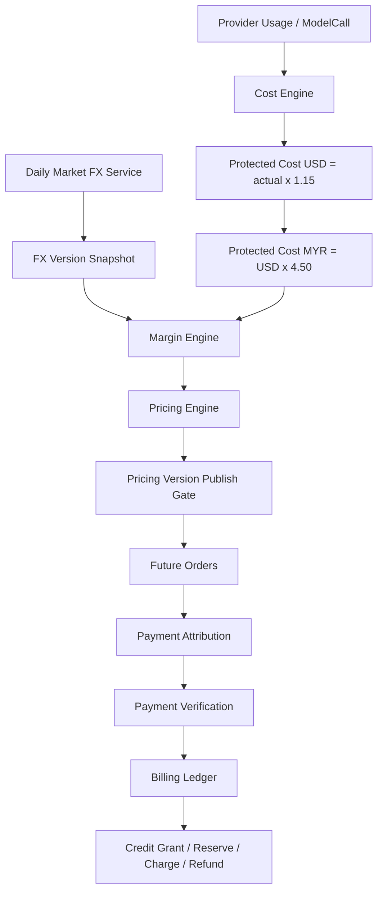

# CortexAI Dynamic Credit Pricing and FX Margin System Design

Feature Name: dynamic-credit-pricing
Updated: 2026-09-23

## Description

本设计为 CortexAI 建立“动态积分定价 + 汇率利润保护 + 可审计账务”的核心闭环。系统读取 Provider 真实 token usage，按 1.15 成本保护与固定 4.50 成本汇率计算保护成本；再按当日市场汇率计算收入，控制毛利在 30% 目标附近，并在 20%/40% 区间外每天最多调价一次。所有订单永久锁价，所有积分余额只通过 Billing Ledger 修改。

## Architecture

## Components and Interfaces

- **Daily FX Job**
  - 拉取 USD/MYR 市场汇率。
  - 成功后创建 `FxVersion`，失败时保留旧版本并阻止发布新价格。
  - 输出：`fxVersionId`、`rate`、`fetchedAt`。

- **Cost Engine**
  - 读取 `ModelCall` 的 `inputTokens`、`outputTokens`、`providerRawUsage`。
  - 按 Provider Pricing Version 的 USD 成本参数计算 `actualCostUsd`。
  - 计算 `protectedCostUsd = actualCostUsd * 1.15`。
  - 计算 `protectedCostMyr = protectedCostUsd * 4.50`。
  - 缺成本参数时不默认 0，进入 review 队列。

- **Margin Engine**
  - 输入：当前 Pricing Version、FxVersion、Cost Engine 汇总。
  - 输出：毛利率、建议调整方向、调整后价格草稿。
  - 规则：`<20%` 加 5%；`>40%` 减 5%；区间内不变。

- **Pricing Engine**
  - 维护不可变 `PricingVersion`。
  - 每日最多发布一次。
  - 发布前执行最低安全价、最高安全价、Package Ladder、Decimal 精度检查。
  - 成功后切换 active version，历史版本只读。

- **Order Lock**
  - 订单创建时保存：`price`、`credits`、`pricingVersionId`、`fxVersionId`、`providerPricingVersionId`、`creditPricingVersionId`。
  - 历史订单只读这些快照，后续版本不得影响。

- **Payment Pipeline**
  - `Payment -> Attribution -> Verification -> Order Paid -> Billing Ledger -> Credit Grant`。
  - 归因字段提升为：`transactionId`、`orderReference`、`providerAccountId`、`amount`、`currency`、`timestamp`、`paymentMethod`、`phone/email`、`displayName`。
  - 姓名仅作辅助证据。
  - 归因失败或歧义进入人工审核。

- **Billing Ledger**
  - 唯一余额修改入口。
  - 支持 `Reserve`、`Charge`、`Refund`。
  - 使用 `idempotency_key` 防重。
  - 余额由 ledger 汇总得出，禁止直接 `balance += credits`。

## Data Models

- **FxVersion**
  - `id`
  - `baseCurrency`
  - `quoteCurrency`
  - `rate`
  - `source`
  - `fetchedAt`
  - `isActive`

- **ProviderPricingVersion**
  - `id`
  - `provider`
  - `inputCostPerMUsd`
  - `outputCostPerMUsd`
  - `cachedCostPerMUsd`
  - `effectiveAt`
  - `expiresAt`

- **CreditPricingVersion**
  - `id`
  - `effectiveAt`
  - `packagesJson`
  - `modelCreditsPerMJson`
  - `minSafePricesJson`
  - `maxSafePricesJson`
  - `status`

- **PricingVersion**
  - `id`
  - `code`
  - `fxVersionId`
  - `providerPricingVersionId`
  - `creditPricingVersionId`
  - `publishedAt`
  - `status`

- **PaymentOrderExtension**
  - `pricingVersionId`
  - `fxVersionId`
  - `providerPricingVersionId`
  - `creditPricingVersionId`
  - `lockedPriceUsd`
  - `lockedCredits`

- **CreditLedger (扩展字段 = 唯一 Billing Ledger)**
  实现中把 `CreditLedger` 扩展为唯一的 Billing Ledger，不再引入平行的 `BillingLedgerEntry` 表，
  以保留 audit subagent 发现的 "single ledger" 原则。新增字段：
  - `status` (`settled` | `reserved`)
  - `currency` (`USD`)
  - `traceId`、`requestId`
  - `provider`、`model`
  - `inputTokens`、`outputTokens`、`totalTokens`
  - `actualCostUsd`、`protectedCostUsd`、`protectedCostMyr` (NUMERIC(20,10))
  - `creditsUsed` (NUMERIC(20,10))
  - `pricingVersionId`
  - 新增索引 `status`、`traceId`、`orderId`

## Correctness Properties

- 任何历史订单都能通过四个版本 ID 还原创建时价格与成本上下文。
- 同一 `idempotencyKey` 最多生效一次。
- 新 Pricing Version 发布失败时 active version 保持不变。
- Package Ladder 校验失败不得发布新版本。
- 成本缺失时不得默认 0，应产生可审计异常。
- 最终价格只能来自服务端 active Pricing Version，前端只展示。

## Error Handling

- FX 获取失败：沿用最近有效 FX Version，禁止发布价格，记录告警。
- Provider 成本缺失：ModelCall 标记 `cost_review_required`，不自动关账。
- 价格越界：钳制到最小/最大安全价格。
- 支付归因失败：订单保持未支付，支付进入人工队列。
- 重复支付：通过幂等键识别并拒绝，不重复发积分。

## Test Strategy

- 单元测试：
  - `1.15` 成本保护公式。
  - 固定 `4.50` 成本汇率公式。
  - 毛利率 20%/40% 分支。
  - Package Ladder 单调性。
  - Decimal 边界与舍入。
- 集成测试：
  - 订单创建锁定版本。
  - 重复幂等键拒绝。
  - FX 失败不发布新版本。
  - 支付归因失败进人工审核。
- 审计测试：
  - 任一历史订单可还原价格、成本、汇率、版本。

## Subscription Pricing and Credit Validity (Pro/Ultra)

- **Scope**: Pro/Ultra 订阅购买与积分包购买共用 Order Lock、Billing Ledger 与版本快照闭环。
- **Order fields**: 订阅订单额外保存 `creditGrantMinor`、`creditValidDays`（订阅固定 30 天，积分包固定 90 天）。
- **Pricing Version**: 订阅价格纳入最低/最高安全价与 Package Ladder 检查；动态调价仅修改订阅 `price`，`credit grant` 数量不变。
- **Ledger credit grant**: 订阅与积分包均由 Billing Ledger 发放，通过 `idempotency_key` 防重，过期积分由 ledger 定期 sweep 处理。

## References

- `server/src/config.ts`
- `server/src/services/exchangeRate.ts`
- `server/src/services/creditLedger.ts`
- `server/src/services/credits.ts`
- `server/src/services/paymentRuntime.ts`
- `server/src/services/paymentAttribution.ts`
- `server/src/services/paymentVerification.ts`
- `server/src/routes/payment.ts`
- `client/src/lib/models.ts`
