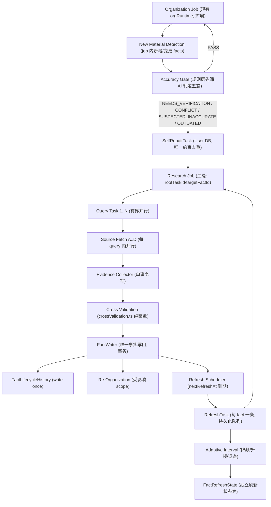

# Knowledge Self-Repair & Lifecycle Refresh

Feature Name: knowledge-self-repair-lifecycle
Updated: 2026-09-27

## Description

在现有 Knowledge Runtime 上补齐"验证 → 自补缺 → 回流 → 周期刷新 → 自适应频率"闭环，
并给 Refresh / Research / Organization 三条链路建立分层有界并发。
四个职责严格分离：整理（结构）、Gate（判定）、Research（证据）、规则层（状态/版本/事务/写口）。

## Architecture

### 闭环主链



### 数据流（两库）

```text
Knowledge DB                    User DB
┌──────────────┬────────────┐   ┌───────────────┬──────────────────┐
│ KnowledgeFact │ FactRefresh│   │ Knowledge     │ SelfRepairTask   │
│ (+时间戳列)   │ State (新) │   │ BlindSpot     │ (新, D1 冻结)    │
├──────────────┤            │   ├───────────────┤                  │
│ FactLifecycle │ Accuracy-  │   │ ResearchJob   │ researchJobId    │
│ History (新)  │ GateDecision│  │ (扩展血缘字段) │ / rootTaskId /   │
│               │ (新)       │   └───────────────┴──────────────────┘
└──────────────┴────────────┘
   Fact = 知识是什么
   FactRefreshState = 什么时候重新验证它 (D4 冻结)
```

### 分层并发模型

```text
Persistent Queue (DB 行: RefreshTask / SelfRepairTask / ResearchJob)
        │  每次 tick 领取 slots 个 (slots = 配额 - 在飞), 不预加载
        ▼
Scheduler (workerPool tick 扩展)
  ├─ Global cap (env, 默认 64, 自适应)
  ├─ Per-kind quota: research / organization / refresh / repair / evolution
  ├─ Per-provider 信号量: google / agnes / search / fetch (429 率驱动缩放, 保底 1)
  ├─ API key lease: 复用 apiKeyPool (least-used + cooldown + 429 切 key)
  ├─ Priority CRITICAL(1) > HIGH(2) > NORMAL(3) > LOW(4)
  ├─ Aging: effectivePriority = base + min(2, floor(wait/30min))
  └─ Per-type fair share: CRITICAL 专轮 + 其余配额轮转
        ▼
Execution (有界并发 mapConcurrent, 禁止 Promise.all(N 万))
  Research Job 内部: Query Task 1..N 并行 (limit=3, 独立任务共享 key pool 无共享状态)
  Query 内部:        Source Fetch A..D 并行 (limit=4, 现有 evidenceCollector 已并行)
  Org Job 内部:      现有 8 workers 保留, 写口仍 Single Writer (orgApplier)
        ▼
Write Control (并发安全的最后闸)
  Org 变更:  mergeResults → preCheck → validator → applyPlan (现状, 保留)
  Fact 真值: FactWriter 单写口, (factId, refreshCycle) 幂等键
  同 fact 并发:  派发前 findFirst(同 fact QUEUED/RUNNING) 查重 + RefreshTask 唯一约束兜底
```

## Components and Interfaces

### 数据库改动（最小增量）

**Knowledge DB（schema-knowledge.prisma）**

```prisma
// KnowledgeFact 加列: lastVerifiedAt DateTime?
// (recordedAt 直接复用 KnowledgeFact.createdAt, 不新增列; 刷新计划字段全部在 FactRefreshState, D4 冻结)

model FactRefreshState {
  id                    String  @id @default(cuid())
  factId                String  @unique
  nextRefreshAt         DateTime
  refreshIntervalMonths Int     @default(1)
  priority              Int     @default(3)      // 1 CRITICAL / 2 HIGH / 3 NORMAL / 4 LOW
  consecutiveFailureCount Int   @default(0)      // D2: 连续失败计数, 成功即清零
  lastRefreshAt         DateTime?
  lastRefreshStatus     String?                 // 七态结果
  pausedUntil           DateTime?               // D2: 达上限后暂停 1 周期
  unchangedStreak       Int     @default(0)
  refreshCycle          String?                 // "YYYY-MM"
  archived              Boolean @default(false) // lifecycle 离开 ACTIVE 时冻结派发 (D3)
  createdAt             DateTime @default(now())
  updatedAt             DateTime @updatedAt
  @@index([nextRefreshAt, archived])
  @@index([refreshCycle])
}

model FactLifecycleHistory {
  id            String   @id @default(cuid())
  factId        String
  eventType     String   // FIRST_RECORDED | VERIFIED | REFRESHED | MATERIAL_CHANGE
                         // | MINOR_CHANGE | CONFLICT_OPENED | CONFLICT_RESOLVED
                         // | SUPERSEDED | INSUFFICIENT_EVIDENCE | SOURCE_GONE | REPAIRED | REFRESH_FAILED
  oldValue      String?
  newValue      String?
  changeType    String?  // 七态
  evidenceIds   String   // JSON array
  sourceIds     String   // JSON array
  researchJobId String?
  refreshTaskId String?
  refreshCycle  String?
  createdAt     DateTime @default(now())
  @@index([factId, createdAt])
  @@index([eventType, createdAt])
}

model AccuracyGateDecision {
  id           String  @id @default(cuid())
  factId       String
  verdict      String  // PASS | NEEDS_VERIFICATION | CONFLICT | SUSPECTED_INACCURATE | OUTDATED
  confidence   Float   @default(0.5)
  evidence     String  // 输入摘要 JSON
  repairTaskId String?
  createdAt    DateTime @default(now())
  @@index([factId, createdAt])
  @@index([verdict, createdAt])
}
```

**User DB（schema-user.prisma，D1 冻结：SelfRepairTask 在此库）**

```prisma
model SelfRepairTask {
  id            String   @id @default(cuid())
  rootTaskId    String
  parentTaskId  String?
  triggerType   String   // ACCURACY_GATE | REFRESH_CONFLICT | SOURCE_GONE | BLIND_SPOT
  targetFactId  String
  reason        String
  iteration     Int      @default(1)
  refreshCycle  String?
  researchJobId String?
  status        String   @default("OPEN") // OPEN | RESEARCHING | EVIDENCE_READY | RESOLVED | CANNOT_VERIFY | TERMINATED
  terminateReason String?
  resultJson    String?
  createdAt     DateTime @default(now())
  updatedAt     DateTime @updatedAt
  @@unique([rootTaskId, targetFactId, refreshCycle, triggerType])  // R3.2 去重, DB 级
  @@index([status, targetFactId])
  @@index([researchJobId])
}

// ResearchJob 加血缘列: rootTaskId String? / targetFactId String? / iteration Int @default(1)
// RefreshTask 新表 (User DB, 与 ResearchJob 同库, 复用其 lease/heartbeat 字段模式):
model RefreshTask {
  id            String   @id @default(cuid())
  factId        String
  refreshCycle  String
  status        String   @default("QUEUED") // QUEUED | RUNNING | UNCHANGED | MINOR_CHANGE | MATERIAL_CHANGE
                                           // | CONFLICT | SOURCE_GONE | UNVERIFIED | REFRESH_FAILED | CANNOT_VERIFY
  priority      Int      @default(3)
  attemptCount  Int      @default(0)
  workerId      String?
  leaseUntil    DateTime?
  heartbeatAt   DateTime?
  startedAt     DateTime?
  completedAt   DateTime?
  lastError     String?
  researchJobId String?
  prevIntervalMonths Int  @default(1)
  newIntervalMonths  Int?
  oldValue      String?
  newValue      String?
  evidenceIds   String?
  resultJson    String?
  createdAt     DateTime @default(now())
  @@unique([factId, refreshCycle])  // R4.3 幂等键
  @@index([status, priority, createdAt])
  @@index([workerId, heartbeatAt])
  @@index([leaseUntil])
}
```

### 新增/改造 service 文件

| 文件 | 职责 |
|---|---|
| `services/knowledgeLifecycle/factTimeStamper.ts` | 首次写 fact 时打时间戳（recordedAt=createdAt、FactRefreshState 初始化、D3 条件过滤） |
| `services/knowledgeLifecycle/accuracyGate.ts` | 规则层先筛（来源权威/独立性/冲突/新鲜度，零模型）→ 灰色项调 Gemini 判定五态 → 非 PASS 建 SelfRepairTask |
| `services/knowledgeLifecycle/factWriter.ts` | 唯一事实写口：事务内 fact 更新 + version+1 + FactLifecycleHistory + FactRefreshState 字段回写 |
| `services/knowledgeLifecycle/refreshScheduler.ts` | 扫描 FactRefreshState（nextRefreshAt<=now AND archived=false AND D3 条件）→ 生成 RefreshTask（幂等） |
| `services/knowledgeLifecycle/refreshWorker.ts` | 执行单个 RefreshTask：并行取源 → 结构化比较（复用 crossValidation.parseValue/valuesAgree）→ 七态结果 → FactWriter → adaptiveInterval |
| `services/knowledgeLifecycle/adaptiveInterval.ts` | 降频/升频/退避纯函数（D2 状态机 + 配置项，无 DB 依赖，单测直测） |
| `services/knowledgeLifecycle/repairIngest.ts` | Research Job 完成钩子：Evidence → crossValidate → FactWriter → 触发 re-org / TERMINATE 判定 |
| `services/utils.ts` | `mapConcurrent(items, limit, fn)` 有界并发池（唯一新增基础设施） |
| `services/workerPool.ts` | 扩展：refresh/repair 两类 job 入池、分层配额、aging、provider 信号量（现有 lease/heartbeat/recoverStale 机制保留） |
| `services/researchExecutor.ts` | query 循环 → `mapConcurrent(queries, 3)`；plan 血缘字段透传 |
| `services/knowledgeOrg/orgRuntime.ts` | Pipeline 插入 Accuracy Gate 扫描（只扫 job 内新增/变更 facts），不改 8 步主体结构 |

### 配置项（env，带默认值，不得写死在逻辑里）

```text
KNOWLEDGE_LIFECYCLE_ENABLED=true          灰度总开关
MAX_CONSECUTIVE_REFRESH_FAILURES=3        D2
PAUSE_CYCLES_AFTER_MAX_FAILURES=1         D2
REFRESH_STABLE_STEPS="1,2,3,6,12"        降频阶梯(月)
REFRESH_HOT_STEP=0.5                      连续变化高频期(月, 2 周)
REFRESH_GLOBAL_CAP=64 / REFRESH_KIND_QUOTA={"research":12,"organization":6,"refresh":32,"repair":6,"evolution":8}
PROVIDER_CONCURRENCY={"google":10,"agnes":10,"search":20,"fetch":8}
REFRESH_QUERY_CONCURRENCY=3 / REFRESH_FETCH_CONCURRENCY=4
```

## Correctness Properties

1. `recordedAt`（=KnowledgeFact.createdAt）在 fact 生命周期内恒定；FactWriter 的任何事务均不触碰该列。
2. 同 (factId, refreshCycle) 至多一个 RefreshTask；同 (rootTaskId, targetFactId, refreshCycle, triggerType) 至多一个 SelfRepairTask（DB 唯一约束，非应用层约定）。
3. fact 真值变更只经 FactWriter 单写口；orgApplier 只管结构（lifecycle/关系/归类），两者事务互斥于 factId。
4. REFRESH_FAILED 不累计 unchangedStreak、不改 refreshIntervalMonths；连续失败计数只在成功时清零（D2）。
5. 非 ACTIVE lifecycle 或 D3 外 verificationStatus 的 fact 不出现在 RefreshScheduler 扫描结果中（FactRefreshState.archived=true 时跳过派发）。
6. AI 输出（Gate 判定 / Research 证据）必须经 Schema 校验 + 五态/七态白名单后才进入规则层；非法值按降级处理。

## Error Handling

| 场景 | 行为 |
|---|---|
| 单个 query 搜索失败 | 该 query 记 ERROR，不拖垮 job；全部 query 失败 → RefreshTask=REFRESH_FAILED（D2 退避），job 走现有 failJob 重试（attemptCount） |
| 来源 404/下线 | SOURCE_GONE → 查替代官方来源 → 不足则 SelfRepairTask；不判 UNCHANGED |
| 抓取超时 | 计入 REFRESH_FAILED；连续 3 次 → LOW + pausedUntil（D2） |
| Gemini Gate 判定不可用 | 规则层保守结论（证据不足 → NEEDS_VERIFICATION），请求不失败 |
| 交叉验证值互斥 | fact → CONFLICTED（保留原值），SelfRepairTask 找独立来源；Rule 层按来源权重 + 独立性裁决 |
| 证据不足 | INSUFFICIENT_EVIDENCE 标记 + 原 fact/历史/证据/查询时间全保留 + 周期缩短 |
| Worker 崩溃 | lease 过期 → recoverStaleJobs 回队列（现有机制）；(factId, refreshCycle) 幂等键防重复写 |
| Provider 429 | apiKeyPool 冷却切 key + provider 并发自动降档；恢复后升档 |

## Test Strategy

按 requirements.md "Verification Plan" 十项执行，对应实现顺序：

1. Schema 迁移 + FactTimeStamper（断言 1、3、5 的前置）
2. adaptiveInterval 纯函数单测（断言 3、4 的状态机全路径，含"失败→失败→成功→失败 ⇒ count=1"）
3. accuracyGate（断言 5 五用例）
4. refreshScheduler + refreshWorker + RefreshTask（断言 2）
5. repairIngest 回流（断言 6）
6. workerPool 分层调度 + mapConcurrent（断言 8、9）
7. orgRuntime 插入 Gate（回归 10）

每一步先写最小实现，跑通对应断言再继续下一步；灰度开关 `KNOWLEDGE_LIFECYCLE_ENABLED` 关闭时所有新链路旁路，行为与现状一致。

## References

- requirements.md（同目录）：12 条闭环原则 + 22 条高并发要求 + 26 条工程纪律 + D1-D4 冻结决策
- 复用组件：`crossValidation.ts`（数值 5% 容差比较，纯函数）、`evidenceCollector.ts`（来源并行抓取 + 单事务写）、`apiKeyPool.ts`（key lease/冷却/切 key）、`workerPool.ts`（lease/heartbeat/recoverStale）、`knowledgeOrg/orgResultPool.ts`（跨 worker 冲突合并）
