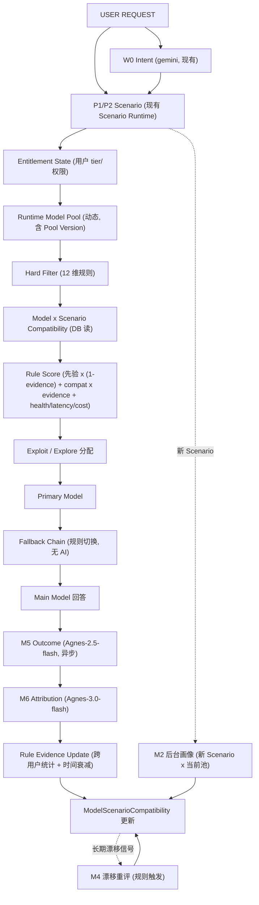

# Scenario-Driven Adaptive Model Routing

Feature Name: scenario-adaptive-model-routing
Updated: 2026-09-27
Status: Architecture Frozen (implementation-ready)

## Description

把现有 `Task → 静态 Task Weights → 模型选择` 升级为 **Scenario-Driven Adaptive Model Routing**：
系统学习"哪个模型适合哪个场景"（Model × Scenario 全局能力知识），
而不是"哪个模型整体更强"（Model Global Score）。

四个职责严格分离：

1. **Model Capability**（模型本身能干什么）—— 全局能力知识
2. **Model Entitlement**（当前用户能不能用）—— 运行时可用性
3. **Model × Scenario Compatibility**（这个模型在这个场景的历史表现）—— 跨用户实验证据
4. **Realtime Rule Router**（<1s 纯规则选择）—— 线上高速消费经验

AI 负责"建立/修正经验"（后台、并行、有界）；规则系统负责"消费经验"（线上、零模型调用）。
AI 永不参与实时路径；AI 永不突破硬过滤；AI 永不写最终 compatibility 值。

## Glossary

- **Global Scenario Registry**: 全系统唯一场景源（`Scenario` 表，knowledge 库）。Model Runtime 与其它系统引用同一 `scenario_id`，不另建场景分类。
- **ModelPoolVersion**: 由"实际可用模型集合 + 模型版本/状态 + 运行时能力"生成的可追踪版本标识。会员名称不进业务判断。
- **Hard Filter**: 规则层 12 维过滤（权限/存在/active/context/modality/capability/health/rate-limit/key 池/区域/部署）。AI 不得突破。
- **Exploit/Explore**: Exploit = 高置信高证据模型；Explore = 让证据不足但有潜力的模型获得真实实验机会（被 AI 明确 reject 的模型不得 Explore）。
- **Cold Start Rule**: 新 Scenario 首次出现且 M2 未完成时，用"候选池 → 硬过滤 → 静态能力先验 → Task Prior → 健康/延迟/成本 → Fallback"立即选一个可执行模型，不阻塞用户。

## Requirements

### R1 — 禁止硬编码模型列表（最高优先级）

1. 路由逻辑中 SHALL 不存在固定模型名称列表，不存在"Free=A/B/C"、"Pro=A/B/C/D"之类的 tier→models 映射常量。
2. 模型候选 SHALL 运行时自动获取：`User → Entitlement/Membership State → 当前可用模型 → Model Registry → 能力/权限/上下文/健康过滤 → 实际候选池`。
3. 现有 `config.ts MODEL_REGISTRY` 只作为 Registry 种子数据；`router.ts getDefaultModel` 的 tier→模型硬编码列表 SHALL 被移除，改为"候选池为空时从当前可用池按规则取默认"。
4. `resolveModelKey` 的 alias 表 SHALL 保留为**解析别名**（不改名），但不得决定可用模型集合。

### R2 — 能力与权限分离

1. `Model × Scenario Compatibility` 只统计**全局能力证据**；任何统计更新 SHALL 带 `scenario_id` 条件，不存在"因会员 A 用不了而降分"的全局路径。
2. 实时选择 SHALL 先用 Entitlement 过滤出可用池，再用 Compatibility 排序；"模型很适合但用户无权限"→ 直接不在候选池；"有权限但不适合"→ 排后或排除。
3. 会员等级变化 SHALL 只影响当前候选池成员，不得污染该模型的兼容矩阵历史。

### R3 — 统一 Scenario Registry

1. Model Router SHALL 使用 Global Scenario Registry 的 `scenario_id`，与 Prompt/Skill/Knowledge 系统共享同一 ID（如 `coding.android.runtime-hook-debugging`）。
2. Model 系统 SHALL 不新建自己的场景分类/枚举；场景识别由 W0 + P1/P2（Scenario-Driven Prompt Runtime）产出，Router 只消费结果。
3. 兼容矩阵、实验、归因、EvolutionCandidate（targetType='model_scenario'）全部以同一 `scenario_id` 为键。

### R4 — Model × Scenario Compatibility（替代全局分）

新增 `ModelScenarioCompatibility` 表（knowledge 库），最小字段：

```text
model_id, scenario_id, compatibility, confidence,
experiment_count, unique_user_count, user_distribution,
success_count, correction_count, verification_count, fallback_count,
recent_performance, scenario_diversity, inherited, inherited_from_scenario_id,
pool_version, evidence_strength(派生值, 每次统计更新时重算), status, last_experiment_at
```

1. 矩阵维度 = `(model_id, scenario_id)`；**不存在** Model Global Score 列。
2. 一次负面实验只能降"该模型 × 该场景"行；矩阵其它行不变（invariant）。
3. 单用户证据上限：evidence_strength = `min(1, unique_user_count/8)*0.5 + min(1, log2(experiment_count+1)/6)*0.3 + (1 - correction_rate)*0.2`（三项各自封顶，用户项主导 0.5）。数学上单用户无法达到 stable 门槛 0.7：1 用户 1000 次 = 0.5*min(1,1/8) + 0.3*min(1,log2(1001)/6) + 0.2*1 = 0.0625 + 0.3 + 0.2 = 0.5625 < 0.7；40 用户 100 次 = 0.5*min(1,40/8) + 0.3*min(1,log2(101)/6) + 0.2*1 = 0.5 + 0.3 + 0.2 = 1.0 ≥ 0.7。`evidence_strength` 为派生列，在每次证据统计更新（M6 回流 / 成功计账）时随统计列同事务重算。
4. 稳定化（stable）要求跨用户：`unique_users >= 3 且 recent_performance >= 0.6 且 evidence_strength >= 0.7`。`scenario_diversity` 定义：该模型在多少个**不同 scenario** 的矩阵行上处于 stable/已验证状态（按模型聚合，非单行属性）；继承行（`inherited=true`）的 `scenario_diversity` 从 0 起算，积累自身真实实验（含跨场景验证）后才计入。
5. 场景继承：新场景首现时，父场景矩阵行作为 prior（`inherited=true` + `inherited_from_scenario_id`），继承行须积累自身真实实验后才参与 stable 判定。

### R5 — 静态 Task 权重仅作冷启动先验

1. 现有 `TASK_WEIGHTS` / quality/speed/reliability/cost 静态画像 SHALL 降级为**先验**：证据积累后，真实 Model × Scenario 证据逐步成为主依据。
2. 先验交接（线性，无跳变）：`staticWeight = 1 - evidence_strength`，`compatWeight = evidence_strength`。es=0 → 纯先验；es=0.3 → 静态 0.7 / 证据 0.3；es=0.4 → 静态 0.6；es=0.6 → 静态 0.4；es=0.7 → 静态 0.3 / 证据 0.7；es=1 → 纯证据。交接公式为单一线性式，四档测试断言 es=0/0.3/0.6/0.9 → staticWeight=1.0/0.7/0.4/0.1。
3. 实时公式（规则）：`final = staticPrior * staticWeight + compatibility * compatWeight + healthTerm + latencyTerm + costTerm + verificationTerm`；各修正项系数由规则配置，AI 不参与。

### R6 — 实时路径零 AI

1. 正常请求（已有 Scenario）：`Scenario → 候选池 → Compatibility → 规则打分 → Primary + Fallback`，SHALL 无任何模型调用，目标 <1s，理想 <100ms（内存/DB lookup + 规则）。
2. W0 Intent 与 Scenario 识别可并行，但 W0 结果不得阻塞 Router；Router 只消费合并后的 `scenario_id`。**快路径守卫**：当请求已携带可解析的 `scenario_id`（来自 P2 匹配命中或会话缓存）时，直接进 Router，不再发起 W0/P1；仅"未知场景"才触发 W0+P1 识别。
3. Fallback 切换 SHALL 不重新调用任何 AI：Primary 不可用 → 直接取 fallback chain 下一位。

### R7 — AI 画像只在"第一次"批量建立（后台异步）

M1 触发点（且仅这些）：
1. 模型选择系统首次初始化；
2. 新 Model 入库；
3. 新 Scenario 入库；
4. Model Pool Version 重大变化；
5. 某 Model × Scenario 检测到长期漂移（M4 规则触发）。

1. 所有画像任务 SHALL 走 Persistent Queue + Bounded Concurrency + API key pool；**禁止 `Promise.all(全矩阵)`**。
2. 500 个 Scenario 出现新模型 → 拆成 500 个独立 `(model, scenario)` 任务并行消费。
3. 新 Scenario 出现 → 只算 `New Scenario × 当前模型池`，不算全矩阵；后台并行，**不阻塞首次用户请求**（首次请求走 Cold Start Rule）。
4. 新模型出现 → 只算 `New Model × Global Scenario Registry`，不重算旧模型。

### R8 — ModelPoolVersion

1. 候选池由 `可用模型集合(按 modelKey) + 各模型 version/status/capabilities + provider 健康状态 + API key 池可用性` 生成可追踪版本：`pool_version_hash = sha1(排序后的 modelKey@version:status:capabilities 列表 | providerHealth 摘要 | keyPoolAvailable)`。hash 输入排序后计算，保证确定性；provider 健康变化与 key 池重大变化都进 hash，使 R8.2 的"重大可用性变化"可被检测到。
2. 候选发生重大变化（新增/删除模型、版本/能力变化、Provider 状态变化、API key 可用性重大变化）→ 创建新 Pool Version。
3. 每次 M1 画像批次记录 `pool_version`（写进 `ModelProfileJob.poolVersion` 列 + 矩阵行 `pool_version`），可回答"这批画像是针对哪个模型池建立的"。
4. 池变化时只重算**受影响**组合（增量），不盲目全量重算：受影响 = 新增模型×全场景 ∪ 删除/降权模型×全场景 ∪ 能力变化模型×全场景。

### R9 — 模型不能空选

1. 实时路由输出 SHALL 永远非空：无高匹配模型 → 取合法候选中最佳；候选池全被过滤 → 放宽到"可执行兜底模型"，仍非空。
   - **兜底模型选择规则**：在 Registry 中 `status=online + enabled + 有可用 API key + tier 可达` 的模型里，取 `静态先验分（capabilityFit+quality 均值）最高且 contextWindow 最大` 的模型；若仍无，则取按 contextWindow 排序最大的在线模型。该规则纯静态、可单测，禁止硬编码模型名。
2. "没有高匹配模型"与"没有可执行模型" SHALL 区分记录（telemetry.reason=`no_match_best_candidate` / `no_executable_model_last_resort`）。
3. Primary 不可用（429/超时/下线）→ 立即走 Fallback Chain（规则，无 AI）。

### R10 — 硬过滤由规则层完成（AI 不可突破）

过滤维度（12 项，全规则层）：会员权限、模型存在、active 状态、Context Limit、Modality、Capability、Provider Health、Rate Limit、API Key 可用性、区域/部署限制、Pool Version 一致性、其它系统硬限制。
1. 流程固定：`Registry → Hard Filter → Candidate Pool → 兼容/先验数据 → Rule Score → Primary/Fallback`。
2. 不存在"AI 先选了一个不可用模型再由系统修正"的路径。

### R11 — Exploit / Explore（一次一模型）

1. 正常 Exploit：高置信 + 高证据的 `(model, scenario)` 行。
2. Explore 比例可配置（默认 ≤10%）：让"证据不足但有潜力"的模型获得真实实验机会（例：A 0.92/1000 次/40 用户 vs B 0.88/20 次/8 用户 → 大部分给 A，小部分给 B）。
   - **Explore 资格下限**：候选必须同时满足 `semantic_fit != 'reject'`（M1/M2 未否决）且 `compatibility >= exploreFloor`（默认 0.4，可配）且有基本证据（`experiment_count >= 1` 或为继承先验行）；低于下限的模型既不进 Exploit 也不进 Explore，只能靠 M4/M6 规则重评重新获得资格。
3. M1/M2 输出 `semantic_fit=reject` 或 M6 归因 `direction=negative` 且 `target=model*` 的模型 SHALL 不参与 Explore（被明确否决后不强行实验）。
4. 一次请求只执行**一个**实际模型（不做双模型同答 A/B）；实验证据来自不同请求/用户/场景实例/时间。

### R12 — 反馈不直接等于失败；Outcome 与 Attribution 分离

1. 用户后续消息 SHALL 先经 M5 Outcome Analysis（八态：success / partial_success / correction / requirement_change / model_issue_signal / scenario_issue_signal / output_issue_signal / uncertain），**不直接**改兼容矩阵。
2. "不错，不过再详细一点" → 典型 partial_success，不计模型负面。
3. "方向完全错了" → 可能 scenario mismatch，归因给 Scenario 而非 Model。
4. M6 Attribution 才决定更新目标：`Model × Scenario` / `Model`（该场景内）/ `Prompt` / `Skill` / `Knowledge` / `Requirement Change` / `Scenario Classification wrong`；归因给 Prompt/Skill 时 Model × Scenario 行不动。
5. M5/M6 只产出带符号系数 + direction；**最终 compatibility 由规则统计引擎**按跨用户证据、时间衰减、置信区间重算并写库（AI 不写 success_rate/compatibility 最终值）。

### R13 — 禁止自我强化闭环

1. Selection（Router 选择）与 Evaluation（M5/M6 评价）SHALL 逻辑隔离：选模型 A 的 M1/M2 先验不得同时充当"A 成功"的评价证据。
2. 闭环固定为 `Selection → Experiment(真实回答) → M5 → M6 → 规则统计更新 → 下一次 Selection`；不允许 `Selection → 同一 AI 自评加分`。

### R14 — 漂移检测（M4 触发）

规则层持续监控每行 `(model, scenario)`：质量骤降、correction 率异常、verification 下降、fallback 增多、错误率异常、模型版本/能力声明变化 → 触发 M4 Re-evaluation（后台、并行、按受影响组合）。
M4 输出：是否存在语义/能力漂移、是否降适配、是否重新实验、是否重建 Initial Prior。M4 不直接改最终 compatibility（规则引擎执行）。

### R15 — 模型不降全局

任何负面归因 SHALL 只更新对应 `(model_id, scenario_id)` 行；Model Registry 无全局质量分列；会员权限变化不产生兼容矩阵写。

## M 系列 Worker 定义（冻结）

| Worker | 模型 | 触发 | 输入 | 输出（JSON，过 Schema 校验） |
|---|---|---|---|---|
| M1 Initial Profiler | Agnes-3.0-flash | 首次初始化 / 新 Model / 新 Scenario / Pool 重大变化 | model profile + scenario 定义 + 场景层级 + capabilities/constraints/modalities/context 需求 + 历史相似场景经验 | semantic_fit(high/medium/low/reject) / capability_fit(0-1) / quality_expectation(0-1) / reason_codes / risk(low/medium/high) / confidence(0-1) / experiment_priority(0-1) |
| M2 New Scenario Profiler | Agnes-3.0-flash | Global Registry 新建 Scenario | 新 Scenario + **运行时实际模型池**（动态获取，非硬编码） | 每模型一组 M1 同构输出（批量并行） |
| M3 New Model Profiler | Agnes-3.0-flash | Model Registry 新增模型 | 新模型 + Global Scenario Registry 全量 | N 个独立任务（N=场景数），队列 + 有界并发 |
| M4 Drift Re-evaluator | Agnes-3.0-flash | R14 规则触发 | 历史矩阵行 + 近期实验 + M5 outcome + 模型当前 profile + 变化信号 | drift(bool) / lower_compatibility(bool) / re_experiment(bool) / rebuild_prior(bool) |
| M5 Model Outcome Analyzer | Agnes-2.5-flash | 用户后续消息 / 明确结果信号（异步） | 原请求 + Scenario + 实际模型 + 原输出 + verification/fallback + 用户后续 | outcome 八态(success/partial_success/correction/requirement_change/model_issue_signal/scenario_issue_signal/output_issue_signal/uncertain) + model_issue_signal(0-1) / scenario_issue_signal(0-1) / output_issue_signal(0-1) / confidence(0-1)（只描述"发生了什么"） |
| M6 Attribution Judge | Agnes-3.0-flash | M5 完成 | M5 + Scenario + Model + Prompt + Skill + Knowledge + verification + 历史实验 | target(model/model_scenario/scenario/prompt/skill/knowledge/requirement_change) / direction(positive/negative/neutral) / strength(带符号系数) / confidence(0-1) / reason（不直接写库） |

统一约束（写入每个 Worker system prompt）：只输出指定 JSON；不输出 markdown；不执行工具；不写数据库；不产出最终路由决策；Model Capability 与 Entitlement 判定分离；禁止在候选中引入无权限模型。

## Architecture

### 主链路（实时，零 AI）



### 后台画像链路（M1-M4，Persistent Queue + Bounded Concurrency + key pool）

```text
ModelProfileJob (User 库, 与 SkillAnalysisJob 同模式)
  kind: modelProfile | modelScenario | driftReeval | outcome | attribution
  lease/heartbeat 复用 workerPool recoverStaleJobs 机制
  任务粒度: 一个任务 = 一个 (model_id, scenario_id) 组合
  并发: 全局 cap + 每 provider 信号量(429 率驱动) + API key pool
  完成钩子: M1/M2 写 Initial Prior(低 evidence_strength) -> 规则层建矩阵行
            M5/M6 输出系数 -> RuleEvidenceUpdate -> 更新矩阵(不覆盖 AI 值以外的字段)
```

## Components and Interfaces

### 新增 Prisma 模型（knowledge 库）

```prisma
model ModelScenarioCompatibility {
  id                 String   @id @default(cuid())
  modelId            String
  scenarioId         String
  compatibility      Float    @default(0.5)
  confidence         Float    @default(0.1)
  evidenceStrength   Float    @default(0)   // 派生值, 每次统计更新时随事务重算
  experimentCount    Int      @default(0)
  uniqueUserCount    Int      @default(0)
  userDistribution   String   @default("[]") // top 用户占比 JSON
  successCount       Int      @default(0)
  correctionCount    Int      @default(0)
  verificationCount  Int      @default(0)
  fallbackCount      Int      @default(0)
  recentPerformance  Float    @default(0.5)
  inherited          Boolean  @default(false)
  inheritedFromScenarioId String? // 继承先验来源场景 (父场景矩阵行)
  lastExperimentAt   DateTime?
  poolVersion        String?
  semanticFit        String?  // M1/M2 初始画像: high | medium | low | reject
  status             String   @default("experimental") // experimental | stable | reevaluating | deprecated
  lastEvaluated      DateTime?
  createdAt          DateTime @default(now())
  updatedAt          DateTime @updatedAt
  @@unique([modelId, scenarioId])
  @@index([scenarioId, compatibility])
  @@index([status, evidenceStrength])
  @@index([modelId])
}

// scenario_diversity 是按模型聚合值（该模型在多少不同场景上达到 stable），
// 不进单行矩阵；独立维护：
model ModelScenarioDiversity {
  modelKey     String  @id
  stableCount  Int     @default(0)
  updatedAt    DateTime @updatedAt
}

model ModelPoolVersion {
  id          String   @id @default(cuid())
  versionHash String   @unique
  modelsJson  String   // 模型 key + version + status + capabilities + providerHealth + keyPool 快照
  triggerType String   // first_init | new_model | new_scenario | pool_change | drift | user_feedback
  createdAt   DateTime @default(now())
}
```

`ModelProfileJob`（user 库）加 `poolVersion String?` 列（R8.3 画像可追溯）。


### 新增 Prisma 模型（user 库，与 SkillAnalysisJob 同模式）

```prisma
model ModelProfileJob {
  id          String   @id @default(cuid())
  jobKind     String   // model_profile | model_scenario | drift_reeval | outcome | attribution
  modelId     String?
  scenarioId  String?
  trigger     String   // first_init | new_model | new_scenario | pool_change | drift | user_feedback
  status      String   @default("QUEUED") // QUEUED | RUNNING | COMPLETED | FAILED
  workerId    String?
  leaseUntil  DateTime?
  heartbeatAt DateTime?
  resultJson  String?
  attemptCount Int     @default(0)
  lastError   String?
  queuedAt    DateTime @default(now())
  completedAt DateTime?
  createdAt   DateTime @default(now())
  updatedAt   DateTime @updatedAt
  @@index([status, queuedAt])
  @@index([jobKind, status])
  @@index([modelId, scenarioId])
  @@index([workerId, heartbeatAt])
  @@index([leaseUntil])
}
```

M2/M3 共用 jobKind：M2（新 Scenario × 当前池）与 M3（新 Model × 全 Registry）都写 `jobKind=model_scenario`，由 `trigger` 字段区分——`trigger=new_scenario` = M2，`trigger=new_model` = M3；M1 首次初始化为 `jobKind=model_profile`。

### 新增/改造 service 文件

| 文件 | 职责 |
|---|---|
| `services/modelEvolution/m1Profiler.ts` | M1 单任务：(model, scenario) 初始语义适配画像（7 字段输出 + Schema 校验） |
| `services/modelEvolution/m2NewScenario.ts` | M2 扇出：新 Scenario × **运行时模型池**（`getDynamicModels + entitlement`，非硬编码）生成 N 个任务 |
| `services/modelEvolution/m3NewModel.ts` | M3 扇出：新 Model × Global Scenario Registry 生成 N 个任务 |
| `services/modelEvolution/m4DriftReeval.ts` | M4：漂移信号 → 判定（4 字段输出） |
| `services/modelEvolution/m5Outcome.ts` | M5：用户后续信号 → 八态 outcome（异步，不阻塞回答） |
| `services/modelEvolution/m6Attribution.ts` | M6：归因（target/direction/strength/confidence/reason） |
| `services/modelEvolution/ruleEvidenceUpdate.ts` | 规则统计引擎：M6 系数 × 时间衰减 × 跨用户证据 → 更新矩阵行（AI 不写最终值） |
| `services/modelEvolution/modelPool.ts` | Pool Version 生成 + 重大变化检测（增量重算决策） |
| `services/modelRouter/scenarioRouter.ts` | 实时零 AI 路由：候选池 + 硬过滤 + 先验/证据交接 + Exploit/Explore + Fallback chain |
| `services/workerPool.ts` | 扩展 job kind `modelProfile`（复用 lease/heartbeat/recoverStale） |
| `services/router.ts` | 现有 `getDefaultModel` 硬编码 tier→模型列表移除；TASK_WEIGHTS 降为先验权重表 |

### 模型分配（冻结）

```text
W0 Intent          gemini-3.5-flash (现有, 不动; 快路径命中已知 scenario 时跳过)
M1/M2/M3/M4/M6     Agnes-3.0-flash  temp 0
M5                 Agnes-2.5-flash  temp 0
现有 Evolution      Agnes-3.0-flash  (不动, 可抽公共 agnesCaller 但不改变其调用行为)
```

### 实时硬过滤 12 维（规则层，AI 不可突破）

```text
1  会员权限 (entitlement)      User.subscriptionTier vs ModelConfig.tier
2  模型存在                   getDynamicModels()[key]
3  active 状态                ModelConfig.status / enabled
4  Context Limit             contextWindow >= estimatedTokens
5  Modality                  category (image/video 排除)
6  Capability                requiredCapabilities >= 50% 匹配
7  Provider Health           modelPerformanceStore.getHealthScore
8  Rate Limit                modelQuotaRegistry.canExecute
9  API Key 可用性             apiKeyPool.getApiKey(provider)
10 区域/部署限制               (预留, 配置项)
11 Pool Version 一致性         row.poolVersion == 当前 poolVersionHash (否则 stale)
12 其它系统硬限制              (预留, 配置项)
```

### 灰度 flag

`CORTX_SCENARIO_MODEL_ROUTING`（环境变量，默认 **off**）：关闭时现有 `router.routeModel` 全链路行为不变；开启时走 `scenarioRouter`。不引入 DB 配置表。

## Correctness Properties

1. 实时路由路径（已有 Scenario）无任何 LLM 调用；`ModelScenarioCompatibility` 读取为单行 point lookup。
2. 兼容矩阵更新必带 `scenario_id` 条件；不存在全局模型降分路径；模型表无全局质量分列。
3. `evidence_strength` 交接（线性，无跳变）：`es < 0.3` 时静态先验权重 >0.7（es=0.3 时恰好 0.7）；`es > 0.7` 时真实证据权重 >0.7（es=0.7 时恰好 0.7）；交接公式 `staticWeight = 1 - es`，es=0→纯先验，es=1→纯证据。
4. 单用户 1000 次成功实验的 evidence_strength < 0.7（数学封顶，R4.3）；40 用户 100 次可过 stable 门槛。
5. M5 `partial_success` / `requirement_change` 不产生 `(model, scenario)` 负面计数；只有 M6 归因 `target=Model` 且 `direction=negative` 才计入 correction/负面。
6. 路由结果永非空：候选池为空时退化为"Registry 中 active 且有 key 的最通用模型"，telemetry 记录 reason=`no_match_fallback`。
7. 同一 `(model, scenario)` 行的 M1 prior 更新只在 pool_version 变化或 M4 `rebuild_prior=true` 时发生；普通实验不覆盖 prior 字段（只更新统计列 + compatibility 由规则引擎重算）。
8. 会员 tier 变化只改变候选池成员；矩阵行 history 与 `user_distribution` 统计不受权限波动污染（权限不足时该用户根本不产生实验行）。
9. AI 输出（M1-M6）写库前过 JSON Schema + 枚举白名单校验；非法值按降级处理（任务 FAILED + 可重试），不污染矩阵。
10. Selection 与 Evaluation 隔离：M1/M2 的 semantic_fit 只写 `quality_expectation/prior` 字段；success 计数只来自真实回答后的 M5/M6 流程。

## Error Handling

| 场景 | 行为 |
|---|---|
| M1-M4 单任务 429/超时 | key pool 冷却切 key；3 次仍失败 → job FAILED，attemptCount+1，下轮 tick 重试 |
| M2 扇出时模型池为空 | 任务标记 SKIPPED（pool_version 记录空池快照），请求走 Cold Start |
| 新 Scenario 首次请求（M2 未完成） | Cold Start Rule 立即选可执行模型（R6.3），同时后台跑 M2 |
| M5 信号不足（uncertain） | 不产生归因；矩阵行只累加 experiment_count，不更新 correction |
| M6 归因 target=Prompt/Skill | Model × Scenario 行不动（R12.4），归因写 AttributionRecord 供 Evolution 消费 |
| 漂移检测（recentPerformance 7 天窗口 < 0.4 且 experiments >= 20） | 规则触发 M4；M4 判定后规则层降 status=experimental + 重新实验，不直接删行 |
| Provider 全挂（健康分 < 0.3） | 硬过滤移除该 provider 全部模型；Fallback chain 跳到下一健康 provider |
| Pool Version 重大变化 | 增量重算：只重算"变化模型 × 全部场景"+"新增场景 × 变化模型"，未受影响组合保留 |
| 实时路由超时（规则层 >200ms 防御） | 直接取候选池第一个健康模型（无降级损失，纯规则本无外部依赖） |

## Test Strategy

按实现顺序，每步先写最小实现 + 断言再继续：

1. **矩阵隔离**：构造 (model X, scenario A) 负面归因 → 断言仅 A 行更新，X 其它场景行与全局列不变（invariant 2/15）。
2. **先验交接**：evidence_strength 0/0.3/0.6/0.9 四档 → 断言静态权重 1.0→0.7→0.4→0.1，compat 权重互补（R5）。
3. **单用户封顶**：1 用户 1000 次成功 vs 40 用户 100 次 → 前者 evidence_strength < 0.7 不可 stable，后者可过（R4.3/4.4）。
4. **实时零 AI**：mock 路由全链路，断言一次路由 0 次 LLM 调用、<100ms；候选池空时退化为"最通用可执行模型"（非空，R9）。
5. **Exploit/Explore**：A(0.92,1000,40u) vs B(0.88,20,8u) → 断言 Explore 流量进 B ≤10%；M1 reject 的模型 C 永不被 Explore（R11.3）。
6. **反馈不误伤**："不错，再详细点" → M5 partial_success → M6 target=Prompt 或 none → 矩阵行 correction_count 不变（R12）。
7. **新 Scenario 冷启动**：M2 未完成时发请求 → 断言 Cold Start 立即返回 + M2 任务已入队（R7.3）。
8. **新模型扇出**：500 场景 + 新模型 → 断言生成 500 个独立任务、并发上限生效、旧模型零重算（R7.2/7.4）。
9. **漂移**：矩阵行 recentPerformance 骤降 → M4 触发 → 规则层 status 降为 experimental；AI 未直接写 compatibility 值（R14）。
10. **自我强化隔离**：同一次实验的 M1 prior 与 success 计数分字段写入；断言"选择"与"评价"不同源（R13）。
11. **Pool Version**：模型增删 → versionHash 变化 → 只重算受影响组合（R8.4）。
12. **回归**：`CORTX_SCENARIO_MODEL_ROUTING` 默认 off，现有 `routeModel` 行为不变；on 时全量 7-8 项断言通过；`npm run build` 全绿。

## References

- 用户需求（19 条原则 + M1-M6 六 Worker + 模型池版本 + Selection/Evaluation 分离 + 冷启动策略）
- 现有源码：`server/src/services/{router,configSync,modelPerformanceStore,modelQuotaRegistry,modelCapabilityRegistry,scenarioRegistry,workerPool,evolution}.ts`、`server/src/config.ts`（MODEL_REGISTRY / PROVIDER_BASE_URLS / getUserAvailableModels）
- 关联 spec：当前工作区 内的 `.monkeycode/specs/scenario-adaptive-prompt-skill-evolution/`（共享 Global Scenario Registry 与 M/P 系列 Worker 的 Scenario ID 语义）
