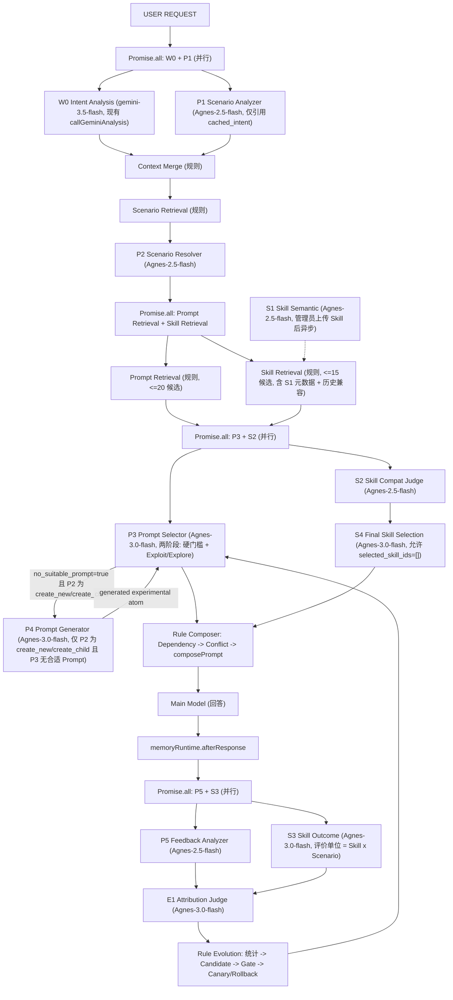

# Scenario-Driven Adaptive Instruction & Skill Evolution

Feature Name: scenario-adaptive-prompt-skill-evolution
Updated: 2026-09-27

## Description

把现有"规则式 Task/Skill 选择 + Gemini 多维意图分析 + Atom/Scenario 拼装"升级为
10 个 AI Worker + 规则层 + Evolution 层的 Scenario-Driven 架构。
AI 负责理解/选择/归因提议，规则系统负责检索/校验/拼装/统计/晋级/回滚，Evolution 负责跨用户证据驱动的下一版策略。

职责口诀：
- Intent 负责"用户想干什么"
- Scenario 负责"具体在哪个场景干"
- Prompt/Skill AI 负责"这次该用什么"
- Composer 负责"怎么拼"
- Feedback/Attribution 负责"哪里出了问题"
- Evolution 负责"下一次怎么更好"

## Architecture

### 实时主链（冻结版）



并行组：
- `Promise.all([W0, P1])`（P1 输入不含本请求 W0 输出，可引用 cached_intent）
- `Promise.all([PromptRetrieval, SkillRetrieval])`（P2 完成后的检索层内部并行）
- `Promise.all([P3, S2])`（检索两侧候选就绪后真正并行）
- `Promise.all([P5, S3])`（用户后续反馈出现时并行）

串行约束：
- P2 依赖 P1 + 检索结果
- S4 依赖 S2
- P4 仅当 P2 ∈ {create_new, create_child} 且 P3 无合适 Prompt 时串行于 P3
- E1 依赖 P5 + S3 均完成
- E1 之后规则统计/Evolution 顺序执行

### 现有调用链改造点（基于源码勘察）

```text
routes/chat.ts buildAgentChat (L51-271)
  L61 classifyTask -> 保留（降级 fallback + 温度输入）
  L119 discoverSkills -> 改条件调用（仅 S2/S4 异常时执行）
  L130 runPromptRuntime -> 内部插入新链（下面详述）
  L173 compilePrompt -> 保留（全链失败兜底）
  L192 finalSystemPrompt -> 改为"新链成功即权威，旧 compiler 不参与"

services/promptRuntime.ts runPromptRuntime (L59-276)
  Step 4 callGeminiAnalysis -> 与 P1 并行（Promise.all）
  Step 4.5 (新增) Context Merge + Scenario Retrieval + P2
  Step 4.6 (新增) Promise.all([P3 链, S2->S4 链])
  Step 6 candidate atoms -> 输入改为 P3 输出（fallback: 现 resolveTaskAtomFallback）
  Step 7/8 依赖/冲突 -> 不变
  Step 10 composePrompt -> 不变（规则系统唯一拼装点）
  Step 12 saveTrace -> 增加 SelectionDecision + ExperimentRun 落库（同库事务）
```

## Components and Interfaces

### 新增 service 文件

| 文件 | 职责 |
|---|---|
| `services/scenarioWorkers/agnesCaller.ts` | 泛化 `callAgnes(model, systemPrompt, userPrompt, maxTokens)`（从 evolution.ts L16-59 抽出共享版），池化 key + 重试 + 超时 |
| `services/scenarioWorkers/p1ScenarioAnalyzer.ts` | P1：输入 R1.2 字段，输出 ScenarioUnderstanding（scenario_signature + 13 字段 + new_scenario_candidate 假设 + confidence） |
| `services/scenarioWorkers/p2ScenarioResolver.ts` | P2：输入 P1 + 检索候选（≤10），输出六态 resolution（reuse_exact/inherit_existing/create_child/create_new/merge_candidate/split_candidate）+ 结构化操作对象 |
| `services/scenarioWorkers/p3PromptSelector.ts` | P3：输入 Resolved Scenario + 候选 Atom（≤20，含 ScenarioPromptCompat 快照），输出 candidates[]（fit_level 五态 + compatibility_estimate + reason_codes + experiment_value）+ selected/experimental ids + no_suitable_prompt；两阶段由规则层执行（R5） |
| `services/scenarioWorkers/p4PromptGenerator.ts` | P4：15 字段 Schema 输出，落库为 draft + experimental version + 兼容矩阵占位行 |
| `services/scenarioWorkers/p5FeedbackAnalyzer.ts` | P5：11 字段输出（outcome 九态 + signals + 三个 *_change_signal 强度值） |
| `services/scenarioWorkers/s1SkillSemantic.ts` | S1：读 Skill 内容，输出 capabilities / constraints / applicable_domains / applicable_task_types / scenario_tags / scenario_features / negative_applicability / required_conditions / optional_conditions；不写 prompt 正文。按内容而非名称泛化（例：名为"高级代码助手"但内容只做 Python 数据分析 → 只打 python/data_analysis 标签，不打 frontend/android 标签） |
| `services/scenarioWorkers/s2SkillJudge.ts` | S2：输入 Resolved Scenario + 候选 Skill（≤15，含 S1 元数据 + 历史兼容数据 + 相似场景结果），输出 decision（use/experimental/reject/none）+ compatibility_score + reason_codes + risk_notes + experiment_value；"语义相似"不等于"应该使用"，相似候选最高只给 experimental |
| `services/scenarioWorkers/s3SkillOutcome.ts` | S3：per-(skill,scenario) 影响评估。impact 九态（skill_helped / skill_harmed / skill_irrelevant / skill_uncertain / scenario_wrong / prompt_wrong / output_wrong / requirement_changed / mixed_cause）；输出 skill_specific_signal / prompt_signal / compatibility_adjustment_direction（increase/decrease/unchanged/uncertain）；因果区分"Skill 能力错"vs"Prompt 约束错"（例：Skill 提供正确分析能力但 Prompt 强制简短回答 → prompt_wrong，不计入该 skill×scenario 负面证据） |
| `services/scenarioWorkers/s4SkillSelection.ts` | S4：结合 S2 输出 + tier 权限 + 版本状态 + 实验约束做最终"是否需要 Skill"语义判断；输出 selected_skill_ids（可空）+ empty_selection + rejected_skill_ids + experiment_candidates；重复功能 Skill 不同时选用，候选非空不强制选择 |
| `services/scenarioWorkers/e1Attribution.ts` | E1：输入 P5+S3+SelectionDecision+兼容快照，输出带符号归因系数 + primary/secondary cause + evolution_actions |
| `services/scenarioRetrieval.ts` | 检索层三个函数：retrieveCandidateScenarios/Atoms/Skills（规则 SQL，上限 10/20/15） |
| `services/evolutionCompat.ts` | `evolveCompatibility(attribution)` + evidence_strength 公式 + 兼容矩阵重算 + canary 流量侧生效逻辑 |

### Worker System Prompt 管理

- 5+4+1 个 Worker 的 system prompt 文本集中在 `services/scenarioWorkers/prompts.ts`（每个 Worker 一个导出常量），与调用代码分离，便于后续调优不发版改逻辑。
- 统一约束（写入每个 prompt）：只输出指定 JSON Schema；不输出 Markdown/解释；不执行工具；不修改数据库；不产出最终 System Prompt；只负责本 Worker 授权判断。

### 10 AI Worker 完整集合（冻结）

| 组 | Worker | 模型 | 阶段 | 职责 |
|---|---|---|---|---|
| Intent | W0 | gemini-3.5-flash（现有 callGeminiAnalysis） | 理解 | "用户想干什么"（MultiDimClassification） |
| P 场景 | P1 | Agnes-2.5-flash | 理解 | "在哪个具体场景干"（scenario_signature + 13 字段） |
| P 场景 | P2 | Agnes-2.5-flash | 理解 | 场景六态裁决（不写库） |
| P Prompt | P3 | Agnes-3.0-flash | 选择 | 候选 Atom 评估（fit_level 五态） |
| P Prompt | P4 | Agnes-3.0-flash | 选择 | 新场景 Prompt 生成（draft + experimental） |
| P 反馈 | P5 | Agnes-2.5-flash | 学习 | "发生了什么"（11 字段，不出归因系数） |
| S Skill | S1 | Agnes-2.5-flash（异步） | 理解 | Skill 语义理解（9 字段，不写 prompt 正文） |
| S Skill | S2 | Agnes-2.5-flash | 选择 | Skill × Scenario 语义适配判定（4 态） |
| S Skill | S3 | Agnes-3.0-flash | 学习 | Skill 影响评估（9 态，评价单位 = Skill × Scenario） |
| S Skill | S4 | Agnes-3.0-flash | 选择 | 最终 Skill 选择（允许空选） |
| E 归因 | E1 | Agnes-3.0-flash | 学习 | 带符号归因系数 + 进化建议 |

### 模型分配（冻结）

```text
W0  gemini-3.5-flash（现有 getDynamicModels 解析，不动）
P1  Agnes-2.5-flash  temp 0
P2  Agnes-2.5-flash  temp 0
P3  Agnes-3.0-flash  temp 0.1
P4  Agnes-3.0-flash  temp 0.3
P5  Agnes-2.5-flash  temp 0
S1  Agnes-2.5-flash  temp 0
S2  Agnes-2.5-flash  temp 0
S3  Agnes-3.0-flash  temp 0
S4  Agnes-3.0-flash  temp 0.1
E1  Agnes-3.0-flash  temp 0
```

### S 系列 Worker 输出 Schema（冻结）

**S1（Agnes-2.5-flash，异步）**
```json
{
  "purpose": "...",
  "capabilities": ["python_data_analysis"],
  "constraints": ["需要真实数据文件", "不支持实时流数据"],
  "applicable_domains": ["data"],
  "applicable_task_types": ["data_analysis", "code_explanation"],
  "scenario_tags": ["data.sql", "data.visualization"],
  "scenario_features": ["pandas", "statistics"],
  "negative_applicability": ["frontend", "android", "system_programming"],
  "required_conditions": ["提供数据样本或 schema"],
  "optional_conditions": ["指定输出格式"]
}
```
规则层落库：写 Skill 表元数据列 + `SkillScenarioLink(autoDerived=true)`。tags 是初始分类，后续按真实实验修正。

**S2（Agnes-2.5-flash）**
```json
{
  "decision": "use | experimental | reject | none",
  "selected_skill_id": "react_debug_skill",
  "compatibility_score": 0.86,
  "confidence": 0.8,
  "reason_codes": ["capability_match", "prior_success", "constraint_satisfied"],
  "risk_notes": "可能引入性能剖析开销",
  "experiment_value": 0.15
}
```
多 Skill 场景：`selected_skill_id` 为数组，逐个给出 decision；候选全不足时 `decision="none"`。

**S3（Agnes-3.0-flash）**
```json
{
  "impact": "skill_helped | skill_harmed | skill_irrelevant | skill_uncertain | scenario_wrong | prompt_wrong | output_wrong | requirement_changed | mixed_cause",
  "skill_specific_signal": 0.62,
  "scenario_specific_signal": 0.58,
  "prompt_signal": 0.1,
  "confidence": 0.7,
  "compatibility_adjustment_direction": "increase | decrease | unchanged | uncertain",
  "evidence": ["用户确认修复点位于 Skill 指出的 re-render 循环"]
}
```
评价单位是 (skill, scenario) 二元组。prompt_signal > 0.5 时该次信号不计入负面兼容证据。

**S4（Agnes-3.0-flash）**
```json
{
  "selected_skill_ids": ["react_debug_skill"],
  "empty_selection": false,
  "confidence": 0.84,
  "selection_reason": "能力与场景直接匹配且历史纠正率低",
  "rejected_skill_ids": ["math_skill"],
  "experiment_candidates": []
}
```
`empty_selection=true` 时 `selected_skill_ids` 必须为 []。倾向空选的情形（写入 system prompt 的判断标准）：
1. Skill 只与话题相关但不提供实际能力；2. Skill 会改变回答方向；
3. 历史实验显示该 Skill 在当前 Scenario 经常造成纠正；4. Skill 与 Prompt 已有能力重复且无增益；
5. Skill 需要的上下文当前不存在；6. Skill 引入无关行为；7. 任务不需要专门能力；
8. 无候选达到合理适配条件。多个高匹配 Skill 并存时按互补性/重复性/冲突/token 成本/实验价值/实际必要性取舍，功能重复者不同时选用。

### 跨用户实验统计字段（Skill/Prompt 矩阵通用）

每张 Compat 矩阵行维护：total_experiments（experiment_count）、unique_users（unique_user_count）、
correction_count、positive_signals、negative_signals、recent_performance（近 7 天 success_rate，供 S2/S4 参考）、
scenario_diversity（该 asset 覆盖的场景数）、user_distribution（top 用户占比，防单用户刷量）。
stable 晋级必须满足：unique_users >= 3 且 scenario_diversity >= 2 且 recent_performance >= 0.6。

### 继承规则（Skill 侧）

场景层级 coding → android → android.runtime → android.hook-debug：
父场景的 `ScenarioSkillCompat` 行作为新场景的 prior（继承值），新场景首次出现时
`success_rate = (父场景 success_rate * 0.4 + 0.5 * 0.6)`（先验混合），并标记 inherited=true。
继承先验不视为已验证证据：该 (skill, new_scenario) 行必须积累自身真实实验后才参与 stable 判定。


## Data Models

全部新增/修改模型见 requirements 附录与下方 prisma 片段（cortex_knowledge 库，除 SkillAnalysisJob 在 cortex_user 库）。

### Scenario 表加列（不迁移数据）

```prisma
model Scenario {
  // ...现有字段...
  path            String?
  parent_id       String?
  parent          Scenario? @relation("ScenarioTree")
  children        Scenario[] @relation("ScenarioTree")
  embedding       String?   // 预留，当前不填值
  status_reason   String?
  merged_into_id  String?
  origin          String @default("seed")  // seed | ai_suggested | admin_created | experiment_promoted
  experiment_count Int @default(0)
  first_seen_at   DateTime?
  last_confirmed_at DateTime?
  @@index([parent_id])
  @@index([path])
}
```

status 枚举扩展：`published | experimental | deprecated | merged`（String 列，无 migration 负担）。
- experimental：AI 建议的新场景，检索层降权 0.7；
- merged：检索排除（WHERE status IN ('published','experimental')），兼容矩阵行 UPDATE 到目标 scenario（证据不销毁）；
- create_child 不改父场景 status。

### 新增表

```prisma
model ScenarioRelation {
  id            String @id @default(cuid())
  source_id     String
  target_id     String
  relation_type String  // similar_to | related_to | split_from | inherited_from
  confidence    Float @default(0.5)
  created_at    DateTime @default(now())
  @@index([source_id])
  @@index([target_id])
}

model ScenarioPromptCompat {
  id                String @id @default(cuid())
  scenario_id       String
  atom_id           String
  experiment_count  Int @default(0)
  unique_user_count Int @default(0)
  positive_signals  Int @default(0)
  negative_signals  Int @default(0)
  correction_count  Int @default(0)
  regression_count  Int @default(0)
  success_rate      Float @default(0.5)
  best_version      String?
  lifecycle         String @default("experimental")  // experimental | stable
  last_evaluated    DateTime?
  created_at        DateTime @default(now())
  updated_at        DateTime @updatedAt
  @@unique([scenario_id, atom_id])
  @@index([scenario_id, success_rate])
}

model ScenarioSkillCompat {
  id                String @id @default(cuid())
  scenario_id       String
  skill_id          String
  skill_version     Int?
  experiment_count  Int @default(0)
  unique_user_count Int @default(0)
  positive_signals  Int @default(0)
  negative_signals  Int @default(0)
  correction_count  Int @default(0)
  success_rate      Float @default(0.5)
  lifecycle         String @default("experimental")
  last_evaluated    DateTime?
  created_at        DateTime @default(now())
  updated_at        DateTime @updatedAt
  @@unique([scenario_id, skill_id, skill_version])
  @@index([scenario_id, success_rate])
}

model SkillScenarioLink {
  id            String @id @default(cuid())
  skill_id      String
  scenario_id   String
  confidence    Float @default(0.5)
  autoDerived   Boolean @default(true)
  rationale     String?
  created_at    DateTime @default(now())
  @@unique([skill_id, scenario_id])
  @@index([scenario_id])
}

model SkillAnalysisJob {  // cortex_user 库
  id          String @id @default(cuid())
  skillId     String
  trigger     String @default("uploaded")  // uploaded | updated
  status      String @default("QUEUED")    // QUEUED | RUNNING | COMPLETED | FAILED
  workerId    String?
  leaseUntil  DateTime?
  resultJson  String?
  queuedAt    DateTime @default(now())
  completedAt DateTime?
  @@index([status])
}

model SelectionDecision {
  id                   String @id @default(cuid())
  trace_id             String
  user_id              String?
  conversation_id      String?
  scenario_id          String?
  secondary_scenario_ids String @default("[]")
  selected_atom_ids    String @default("[]")
  selected_skill_ids   String @default("[]")   // 允许空数组
  prompt_compat_snapshot String?
  skill_compat_snapshot  String?
  model                String?
  source               String @default("ai")   // ai | rule_fallback | legacy_compiler
  fallback_reason      String?
  outcome              String @default("pending")
  experiment_id        String?
  created_at           DateTime @default(now())
  @@index([trace_id])
  @@index([scenario_id])
}

model ExperimentRun {
  id             String @id @default(cuid())
  decision_id    String
  user_id        String
  scenario_id    String?
  atom_versions  String @default("{}")
  skill_versions String @default("[]")
  model          String?
  input_context_hash String?
  follow_up_id   String?
  feedback_signal String @default("none")
  outcome        String @default("unknown")
  attribution_ref String?
  experiment_type String @default("real")  // real | synthetic
  created_at     DateTime @default(now())
  @@index([user_id, created_at])
  @@index([scenario_id])
  @@index([decision_id])
}

model AttributionRecord {
  id                  String @id @default(cuid())
  experiment_id       String
  feedback_message_id String?
  feedback_analysis   String @default("{}")  // P5 输出（"发生了什么"）
  skill_assessment    String @default("{}")  // S3 输出
  attribution         String @default("{}")  // E1 带符号系数
  primary_cause       String?
  scenario_precision_delta Float @default(0)
  worth_evolving      Boolean @default(false)
  created_at          DateTime @default(now())
  @@index([experiment_id])
}
```

### 现有表加列

- `Skill` 表：`capabilities String @default("[]")`、`constraints String @default("[]")`、`applicable_domains String @default("[]")`、`applicable_task_types String @default("[]")`、`scenario_features String @default("[]")`、`negative_applicability String @default("[]")`、`required_conditions String @default("[]")`、`optional_conditions String @default("[]")`（S1 九字段全量落库）、`triggers String @default("[]")`（从 skills.ts 常量迁移）、`requiredTier String @default("STANDARD")`、`version Int @default(1)`、`analysisStatus String @default("pending")`、`lastAnalyzedAt DateTime?`。不加全局质量分列（R8 硬约束）。
- `ScenarioSkillCompat`：加 `inherited Boolean @default(false)`（继承先验标记，继承行不参与 stable 判定直至积累自身实验）+ `recent_performance Float @default(0.5)`（近 7 天窗口）。
- `ScenarioPromptCompat`：同步加 `recent_performance`。
- `EvolutionCandidate`：`experiment_ref String?`、`targetScenarioId String?`；targetType 值域扩展 `prompt_version | skill | scenario`。
- `PromptTrace`：新增 `decision_id String?` 关联 SelectionDecision。

## Implementation Status

4 项实现项已全部落地（代码已提交到 server）：

| 项 | 状态 | 实现位置 |
|---|---|---|
| **AI 不直接发布正式 Skill** | ✅ 已实现 | `services/skillPublishGuard.ts`（`guardSkillPublication` + `assertNoGlobalSkillQualityWrite`）；admin routes `routes/knowledge.ts` POST/PUT /skills + `services/importService.ts` ZIP 导入 全部走 guard；`ai_generated`/`auto_derived`/`unknown` 来源一律拒绝。Skill 表无全局质量列（invariant 3 由 `assertNoGlobalSkillQualityWrite` 运行时强制）。 |
| **实际 Worker 调用** | ✅ 已实现 | `services/scenarioWorkers/` 全 10 Worker（P1/P2/P3/P4/P5 + S1/S2/S3/S4 + E1）+ 共享 `agnesCaller.ts`（池化 key + 429/5xx 重试 + 超时 + `parseWorkerJson` 枚举白名单校验）。S1 经 `services/skillAnalysisWorker.ts` 接入 workerPool（新 `skillAnalysis` job kind），admin 写 Skill 即 enqueue。 |
| **数据库 migration** | ✅ 已实现 | `prisma/schema-knowledge.prisma`：Skill 加 S1 九列 + version/analysisStatus；Scenario 加 path/parent_id/status 扩展/origin/experiment_count；新增 7 表 `ScenarioRelation`/`ScenarioPromptCompat`/`ScenarioSkillCompat`/`SkillScenarioLink`/`SelectionDecision`/`ExperimentRun`/`AttributionRecord`；`EvolutionCandidate` 加 experiment_ref/targetScenarioId；`PromptTrace` 加 decision_id。`prisma/schema-user.prisma`：新增 `SkillAnalysisJob`。全部 `db push` 已应用 + client 已生成。 |
| **Runtime 真正接入** | ✅ 已实现 | `services/scenarioRuntime.ts`（`runScenarioRuntime` 编排：P1→P2→检索→P3∥S2→P4 条件触发→S4→规则两阶段→SelectionDecision 落库）；`services/promptRuntime.ts` 在 Step 4 后按 `CORTX_SCENARIO_RUNTIME` flag 灰度接入（默认 off，新链成功即权威 atom 选择）；`routes/chat.ts` 在 flag on 时以 S4 `selectedSkillIds` 为权威 skill 源（`discoverSkills` 降级为纯 fallback）。 |

### 验证结果

- `npx tsc --noEmit`：0 error；`npm run build`：通过
- `test/scenarioRuntime.test.js`（契约）：**18/18** — SkillPublishGuard 硬拒绝 AI/自动派生来源、全局质量列写保护、parseWorkerJson 枚举门控、P3 两阶段（reject 排除 + 安全 atom 不可 delta + Exploit/Explore）、S4 空选不变量
- `test/scenarioRuntime.e2e.js`（降级 smoke）：**6/6** — flag on 且无 Agnes key 时 P1/P2/P3/S2/S4 逐级 rule fallback，`degraded=true`，请求不崩，最终 System Prompt 仍由规则 Composer 产出
- 既有 `test/knowledgeLifecycle.test.js`（30/30）+ `test/knowledgeLifecycle.e2e.js`（17/17）回归全绿

### 灰度与回滚

- `CORTX_SCENARIO_RUNTIME` 默认 **off**：关闭时 `promptRuntime` 不跑新链，`chat.ts` 走原 `discoverSkills` 路径，行为与旧版完全一致（invariant / R14.8）。
- 开启后全链失败仍自动回落 legacy compiler（R14.2），新链任何单点降级都不阻塞请求。

## Correctness Properties

不变量（invariants）：

1. 最终 System Prompt 只由 `composePrompt` 产出；任何 AI Worker 的输出都不直接成为 system prompt 全文。
2. `selected_skill_ids` 为空是合法终态；规则层不得在空结果时强行回填 discoverSkills 结果（仅异常降级路径允许，且必须记 fallback_reason）。
3. ScenarioSkillCompat / ScenarioPromptCompat 更新必须带 `scenario_id` 条件（SQL 层隔离），不存在全局 Skill 降分路径。
4. AI Worker 输出写库前必须过 JSON Schema 校验 + 枚举白名单（fit_level 五态、resolution 六态、outcome 九态），非法值按降级处理而非丢弃请求。
5. `core.truth_standard` / category IN ('safety','privacy') 的 atom 永远走 composePrompt 内部无条件追加路径，不受 P3 选择/delta 影响。
6. experimental scenario 的检索权重乘 0.7；merged scenario 不出现在任何检索结果中。
7. single-user 证据上限：evidence_strength 公式中 `min(1, log2(experiment_count+1) * 0.3) + min(1, unique_user_count/5) * 0.4 + (1 - correction_rate) * 0.3`，三项各自封顶，单用户数学上无法达到 stable 门槛 0.7。
8. 跨库写入保持现状模式：SelectionDecision/ExperimentRun/AttributionRecord/兼容矩阵 全在 cortex_knowledge 单库事务；EvolutionCandidate（同库）通过后才按现有跨库惯例写 cortex_user 的 memoryEntry。

## Error Handling

降级矩阵（R14）：

| 失败点 | 行为 | 记录 |
|---|---|---|
| P1 超时/解析失败 | 跳过 P2，用 W0 domains+tasks 规则拼 scenario_signature（degraded=true） | SelectionDecision.source='rule_fallback', fallback_reason='p1_failed' |
| P2 失败 | 用检索层 Top-1 候选直接作为 matched（不创建新场景） | fallback_reason='p2_failed' |
| P3 失败 | 候选 atom 退化为检索层原始输出（不做 AI 加权），不阻塞请求 | fallback_reason='p3_failed' |
| P4 失败 | 视同 no_suitable_prompt，本次只用继承候选；P4 重试 1 次 | fallback_reason='p4_failed' |
| S2/S4 失败 | discoverSkills 规则兜底（唯一合法触发点） | fallback_reason='skill_chain_failed' |
| composePrompt 异常 | 全链失败 → 旧 compiler 完整路径（现状 L192 分支真正生效的唯一场景） | trace status='degraded' |
| P5/S3 失败 | 静默跳过，不阻塞；E1 无输入则本次不产生归因 | AttributionRecord 不写入 |
| E1 失败 | 本次反馈只留 P5/S3 输出，归因延后到下次同类信号 | EvolutionJob 可重试（10 分钟 dedupe 窗口内） |

所有 AI 调用走 `agnesCaller` 统一 helper：池化 key、429/5xx 重试（复用 evolution.ts L16-59 模式）、超时控制、失败抛出由调用方决定降级。

## Test Strategy

1. **单元（Worker 契约测试）**：每个 Worker 用固定 fixture（输入 JSON + mock 模型返回）断言输出 Schema 合法、枚举值在白名单内；特别覆盖：P3 reject 不进入 experimental、S4 空选合法、P2 六态各一例、P4 15 字段完整性。
2. **并行性验证**：对 W0/P1、P3/S2、P5/S3 三组并行调用，mock 每个调用耗时 500ms，验证每组总耗时为 500ms 量级（而非串行 1000ms），确认并行路径真正生效。
3. **降级矩阵**：逐个注入超时/坏 JSON，断言 SelectionDecision.source 与 fallback_reason 按矩阵记录，且最终 system prompt 非空、请求成功。
4. **兼容矩阵隔离**：构造 (skill A, scenario X) 负面归因，断言 ScenarioSkillCompat 仅 X 行更新，X 之外所有行 success_rate 不变；Skill 表无全局分列。
5. **证据强度公式**：构造单用户 1000 次成功实验 + 5 用户 10 次实验两组数据，断言前者 evidence_strength < 0.7（不可 stable），后者可超过门槛。
6. **S3 因果区分**：构造"Prompt 强制简短、用户要求详细、Skill 能力方向正确"用例，断言 impact=prompt_wrong、该次不计入 (skill, scenario) 负面信号；反向构造"Skill 选错方向"用例，断言 prompt_signal 保持低值。
7. **S4 空选与重复性**：构造候选全为 reject 用例断言 empty_selection=true 且 selected_skill_ids=[]；构造两个功能重复的高匹配 Skill 用例，断言不同时入选。
8. **回归**：`npm run build`（tsc）全绿；现有 `POST /api/prompt/compose` 与 chat 主链行为在 feature flag 关闭时与旧版本一致（新链以 flag `CORTX_SCENARIO_RUNTIME=on` 灰度，默认 off 上线第一阶段）。

## References

- 用户需求（架构级重构 Prompt Runtime / Scenario / Skill / Evolution，21 条原则）
- 用户冻结版修正（17 项：P1 真并行、Skill 保留 AI、E1 独立、六态 resolution、两阶段选择、P4 不锁死兼容、P1 只提假设、检索语义化、AI 不写 success_rate、完整主链、模型分配、不做 Fast Path、三层结构）
- 用户 Skill Runtime 正式 Prompt（S1-S4 四 Worker System Prompt + Skill 根本原则 + 跨用户实验规则 + Skill×Scenario 矩阵 + 继承规则 + 十条禁止行为）
- 源码勘察报告：`server/src/services/{contextAnalyzer,scenarioRegistry,promptRuntime,promptComposer,promptRegistry,compiler,skills,evolution,evolutionManager,evolutionBudget,workerPool,taskTaxonomy,taskClassifier}.ts`、`server/src/routes/{chat,knowledge,prompt,import}.ts`、`server/prisma/schema-knowledge.prisma`
